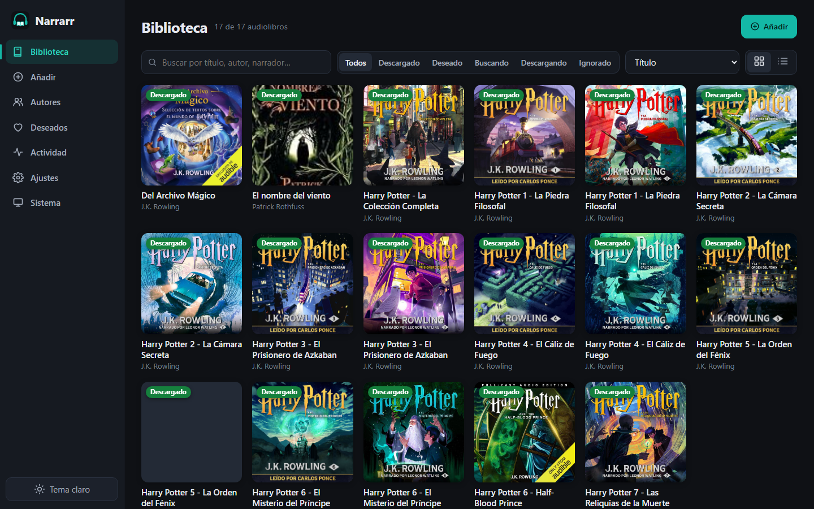
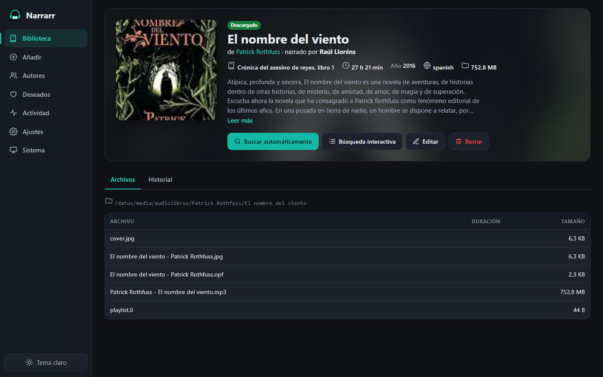

<p align="center"></p>

# Narrarr

Gestor tipo *arr de **audiolibros**, todo en **castellano**. Le dices qué libros quieres (o qué autores vigilar), y Narrarr los busca en tus indexadores, los descarga con qBittorrent y los deja ordenados en tu biblioteca con portada y metadatos, listos para Jellyfin, Emby o Audiobookshelf.

[](https://hub.docker.com/r/nemesbak/narrarr)
[](https://hub.docker.com/r/nemesbak/narrarr)

[](LICENSE)

Elige cómo instalarlo: [Unraid](#️-unraid), [docker run](#-docker-run) o [Docker Compose](#-docker-compose).

## Por qué

Readarr está abandonado y nunca se llevó bien con los audiolibros; LazyLibrarian funciona, pero es antiguo, en inglés y no sabe qué es un narrador. Narrarr nace para quien tiene audiolibros **en castellano**:

- **Metadatos de Audible España**: título, autor, **narrador**, serie, **duración**, sinopsis y portada buena.
- **Búsqueda en Prowlarr** con una puntuación que **prioriza el castellano** y descarta latino, inglés, resúmenes y ebooks.
- **qBittorrent** con su propia categoría.
- **Importación con hardlink**: nunca mueve nada, así que sigues sembrando en tus trackers privados sin ocupar el doble.
- Deja `cover.jpg` y `metadata.json` en cada libro: **Jellyfin, Emby y Audiobookshelf** lo entienden.

## Capturas




## Características

- Interfaz web moderna y oscura (con tema claro), responsive y 100 % en castellano.
- Biblioteca en rejilla de portadas con filtros, búsqueda, orden y vista lista.
- Añadir desde Audible con un clic («Añadir» o «Añadir y buscar»); avisa si ya lo tienes.
- Autores vigilados: cuando sale un libro nuevo en castellano, se añade como deseado.
- Búsqueda automática y **búsqueda interactiva** con la puntuación y los motivos de cada lanzamiento.
- Cola de descargas en directo e historial.
- Escanea tu biblioteca existente (duración, tamaño, portada) y la completa con Audible.
- Avisos por Telegram y refresco de Jellyfin/Emby al importar.
- Freno anti-baneo para trackers privados.
- Un solo contenedor, SQLite, sin dependencias en la nube ni CDN: funciona en la LAN sin internet salvo para buscar.

## Comparativa

| | Narrarr | LazyLibrarian | Readarr | Audiobookshelf |
|---|---|---|---|---|
| Consigue los libros (indexadores + descargas) | Sí | Sí | Sí (abandonado) | No |
| Interfaz en castellano | Sí | No | Parcial | Sí |
| Narrador y duración | Sí (Audible ES) | No | Limitado | Sí |
| Prioriza versiones en castellano | Sí | No | No | — |
| Reproduce audiolibros | No | No | No | Sí |

**Audiobookshelf es un reproductor; Narrarr consigue los libros.** Se complementan: apunta Audiobookshelf a la misma carpeta `/audiolibros` y leerá el `metadata.json` y la portada que deja Narrarr.

## Instalación

### 🟧 Unraid

En **Apps** (Community Applications) busca *Narrarr* y pulsa *Install*. Si aún no aparece, en **Docker → Add Container** pega esta URL en *Template*:

```
https://raw.githubusercontent.com/nemesbak/narrarr/main/unraid-template/narrarr.xml
```

Revisa las tres rutas, pulsa *Apply* y abre la WebUI. Las conexiones (Prowlarr, qBittorrent…) se pueden rellenar en la plantilla (opciones avanzadas) o después en **Ajustes**.

### 🐳 docker run

```bash
docker run -d --name narrarr \
  -p 8787:8787 \
  -e PUID=99 -e PGID=100 -e TZ=Europe/Madrid \
  -v /mnt/user/appdata/narrarr:/config \
  -v /mnt/user/datos/media/audiolibros:/audiolibros \
  -v /mnt/user/datos/torrents/audiolibros:/descargas \
  --restart unless-stopped \
  nemesbak/narrarr:latest
```

### 📦 Docker Compose

```yaml
services:
  narrarr:
    image: nemesbak/narrarr:latest
    container_name: narrarr
    ports:
      - "8787:8787"            # http://IP-DE-TU-SERVIDOR:8787
    environment:
      - PUID=99
      - PGID=100
      - TZ=Europe/Madrid
      # Opcionales (también en Ajustes):
      # - PROWLARR_URL=http://192.168.1.10:9696
      # - PROWLARR_KEY=tu_api_key
      # - QBIT_URL=http://192.168.1.10:8080
      # - QBIT_USUARIO=admin
      # - QBIT_CLAVE=secreto
      # - QBIT_RUTA_REMOTA=/datos/torrents/audiolibros
    volumes:
      - ./config:/config
      - /ruta/a/audiolibros:/audiolibros
      - /ruta/a/torrents/audiolibros:/descargas
    restart: unless-stopped
```

> Para que el **hardlink** funcione, `/audiolibros` y `/descargas` tienen que estar en el **mismo sistema de archivos** (en Unraid, el mismo share, p. ej. `datos`). Si no, Narrarr copia (funciona igual, pero ocupa el doble).

## Volúmenes y variables

| Volumen | Qué guarda |
|---|---|
| `/config` | Base de datos (`narrarr.db`), portadas en caché y log |
| `/audiolibros` | Tu biblioteca ordenada |
| `/descargas` | Donde qBittorrent deja los audiolibros terminados |

Todas las variables son opcionales y también se editan en **Ajustes** (lo guardado en Ajustes manda sobre la variable).

| Variable | Por defecto | Para qué |
|---|---|---|
| `PUID` / `PGID` | `99` / `100` | Dueño de los archivos creados |
| `TZ` | `Europe/Madrid` | Zona horaria |
| `NARRARR_PUERTO` | `8787` | Puerto interno de la web |
| `PROWLARR_URL` / `PROWLARR_KEY` | — | Conexión a Prowlarr |
| `QBIT_URL` / `QBIT_USUARIO` / `QBIT_CLAVE` | — | Conexión a qBittorrent |
| `QBIT_CATEGORIA` | `audiolibros` | Categoría en qBittorrent |
| `QBIT_RUTA_REMOTA` | — | Ruta de las descargas según qBittorrent (ver abajo) |
| `TELEGRAM_TOKEN` / `TELEGRAM_CHAT` | — | Avisos por Telegram |
| `JELLYFIN_URL` / `JELLYFIN_KEY` | — | Refrescar Jellyfin al importar |
| `EMBY_URL` / `EMBY_KEY` | — | Refrescar Emby al importar |

## Primeros pasos

1. **Prowlarr** — En Ajustes pon la URL y la API key (Prowlarr → *Settings → General*) y pulsa *Probar conexión*. Asegúrate de que tus indexadores de audiolibros tienen la categoría **3030 Audio/Audiobook** (Narrarr busca en 3030 y 3000).
2. **qBittorrent** — URL, usuario y contraseña de la WebUI. Crea en qBittorrent la categoría **`audiolibros`** con su ruta de guardado (p. ej. `/datos/torrents/audiolibros`).
3. **Rutas** — Narrarr necesita ver los archivos que deja qBittorrent. Si los dos contenedores montan la carpeta con rutas distintas, indica en `QBIT_RUTA_REMOTA` la ruta **tal como la ve qBittorrent**:

   | | Carpeta en el host | Dentro del contenedor |
   |---|---|---|
   | qBittorrent | `/mnt/user/datos` | `/datos` → guarda en `/datos/torrents/audiolibros` |
   | Narrarr | `/mnt/user/datos/torrents/audiolibros` | `/descargas` |

   Aquí `QBIT_RUTA_REMOTA=/datos/torrents/audiolibros`: cuando qBit diga `/datos/torrents/audiolibros/Libro X`, Narrarr lo buscará en `/descargas/Libro X`. Si ambos usan la misma ruta, déjala vacía.
4. **Añadir** — Busca un libro, pulsa «Añadir y buscar» y míralo aparecer en **Actividad**.

## Cómo puntúa

Cada lanzamiento recibe una puntuación; en la búsqueda interactiva ves los motivos.

| Criterio | Puntos |
|---|---|
| Castellano detectado (`español`, `castellano`, `spa`, `esp`…) | +100 |
| Latino / inglés sin castellano | −1000 |
| Resumen, ebook, epub, pdf, mobi, azw | −500 |
| Formato m4b / mp3 / flac | +40 / +20 / +10 |
| Íntegro (`unabridged`) | +20 |
| Abreviado (`abridged`) | −50 |
| Coincidencia de título | +0 a +60 (sin coincidencia → rechazado) |
| Coincidencia de autor | +0 a +30 |
| Semillas | +1 por semilla, máx. +20 (0 semillas → rechazado) |
| Tamaño < 5 MB o > 10 GB | rechazado |

## Planificador y freno anti-baneo

| Tarea | Cada | Qué hace |
|---|---|---|
| `comprobar_descargas` | 1 min | Sigue la cola de qBittorrent e importa lo terminado |
| `buscar_deseados` | 6 h | Busca los libros deseados **con freno** |
| `escanear_biblioteca` | 12 h | Relee la biblioteca en disco |
| `vigilar_autores` | 24 h | Añade como deseados los libros nuevos de autores vigilados |

Los trackers privados banean a quien busca en masa, así que `buscar_deseados` busca **como mucho 5 libros por pasada**, espera **30 s entre búsquedas** y no repite un mismo libro **más de una vez cada 24 h**. Vigilar autores solo añade deseados; nunca dispara búsquedas en bloque. Todas las tareas se pueden lanzar a mano en **Sistema**.

## Estructura resultante

```
/audiolibros/
  Carlos Ruiz Zafón/
    La sombra del viento (Jordi Boixaderas)/
      La sombra del viento.m4b
      cover.jpg
      metadata.json
  Autor sin narrador conocido/
    Título/
      01 - Capítulo 1.mp3
      02 - Capítulo 2.mp3
      cover.jpg
      metadata.json
```

Solo se importan archivos de audio (`m4b m4a mp3 flac ogg opus aac wma`). El original sigue en `/descargas` sembrando.

## API REST

Todo bajo `/api`, en JSON. Los errores devuelven `{ "detalle": "mensaje" }`.

| Método | Ruta | Qué hace |
|---|---|---|
| GET | `/api/estado` | Versión, conexiones, recuento por estado, espacio libre |
| GET / POST | `/api/libros` | Listar (`estado`, `q`, `orden`) / añadir (`asin` o `titulo`+`autor`, `buscar_ya`) |
| GET / PATCH / DELETE | `/api/libros/{id}` | Ficha / editar / quitar (`borrar_archivos`) |
| GET | `/api/metadatos/buscar?q=` | Buscar en Audible ES |
| GET / POST | `/api/autores` | Listar / añadir autor |
| GET / PATCH / DELETE | `/api/autores/{id}` | Ficha / vigilar / quitar |
| GET | `/api/lanzamientos` | Buscar en Prowlarr (`libro_id` o `q`) con puntuación |
| POST | `/api/lanzamientos/capturar` | Mandar un lanzamiento a qBittorrent |
| GET | `/api/descargas` | Cola actual |
| DELETE | `/api/descargas/{id}` | Quitar descarga (`borrar_datos`) |
| POST | `/api/descargas/{id}/importar` | Importar a mano |
| GET | `/api/historial` | Historial |
| GET / PUT | `/api/ajustes` | Leer (claves enmascaradas) / guardar ajustes |
| POST | `/api/ajustes/probar/{servicio}` | Probar prowlarr, qbit, telegram, jellyfin o emby |
| GET / POST | `/api/tareas` · `/api/tareas/{nombre}` | Ver tareas / lanzar una ya |
| GET | `/api/portada/{libro_id}` | Portada del libro |
| GET | `/api/sistema/log` | Últimas líneas del log |

## Preguntas frecuentes

**¿Por qué no mueve los archivos?** Porque en trackers privados hay que seguir sembrando. Con hardlink el libro está en los dos sitios sin ocupar más.

**Se importa copiando y ocupa el doble.** `/audiolibros` y `/descargas` están en sistemas de archivos distintos. En Unraid, ponlos en el mismo share y monta rutas de `/mnt/user/...` (no mezcles `/mnt/cache` con `/mnt/user`).

**La descarga termina pero no se importa.** Casi siempre es la ruta: revisa `QBIT_RUTA_REMOTA` y mira el log en **Sistema**.

**Encuentra versiones en latino o en inglés.** Se rechazan con −1000 salvo que el título diga también castellano. Si un indexador no etiqueta el idioma, usa la búsqueda interactiva.

**¿Jellyfin muestra el narrador?** Jellyfin y Emby leen la carpeta y la portada; Audiobookshelf además lee `metadata.json` con narrador, serie y ASIN.

**¿Mis API keys se ven en la web?** No: al leer los ajustes salen como `••••`.

## Desarrollo local

```bash
cd docker-app
python -m venv .venv && . .venv/bin/activate
pip install -r requirements.txt
export NARRARR_CONFIG=./config NARRARR_BIBLIOTECA=./audiolibros NARRARR_DESCARGAS=./descargas
python -m uvicorn app.main:app --reload --port 8787
python -m pytest -q app/tests   # tests de puntuación
```

O con Docker: `docker build -t narrarr docker-app && docker run -p 8787:8787 -v ./config:/config narrarr`.

## Licencia

[MIT](LICENSE) © 2026 nemesbak
